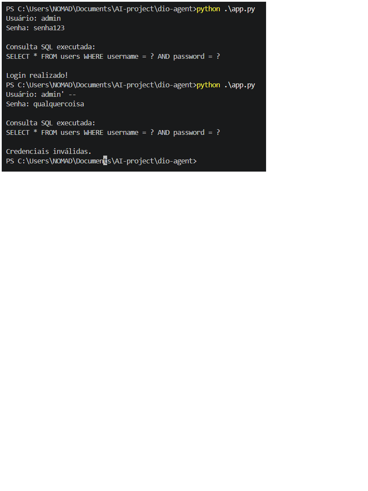

# DIO Agent — Mentor de Segurança de Aplicações (AppSec)

## 📌 Sobre o projeto

Este projeto foi desenvolvido como desafio final de um curso de cibersegurança da DIO.

O objetivo foi especializar o DIO Agent para atuar também como mentor de segurança de aplicações (AppSec), orientando o estudante na compreensão, análise, validação e correção de vulnerabilidades.

A implementação utiliza uma skill especializada, uma base de conhecimento de segurança e atualizações na persona e nas instruções do agente.

## 🎯 Objetivos

- Especializar o DIO Agent em segurança de aplicações.
- Desenvolver o raciocínio técnico durante a análise de vulnerabilidades.
- Diferenciar fatos, inferências e hipóteses.
- Compreender autorização, contexto e escopo de testes.
- Orientar a identificação e correção de vulnerabilidades.
- Validar correções por meio de testes controlados.
- Estimular a autonomia do estudante.

## 🧪 Laboratório prático: SQL Injection

Foi desenvolvido um laboratório em Python utilizando SQLite para demonstrar uma vulnerabilidade de SQL Injection em um mecanismo de autenticação.

### Etapas realizadas

1. Implementação inicial de uma consulta SQL vulnerável por concatenação de entradas.
2. Reprodução controlada de um bypass de autenticação.
3. Identificação da causa da vulnerabilidade.
4. Correção utilizando consultas SQL parametrizadas.
5. Teste de autenticação legítima após a correção.
6. Verificação de que o payload utilizado no laboratório não permite mais o bypass.

### Correção implementada

A mitigação utiliza parâmetros separados da instrução SQL:

```python
cursor.execute(
    "SELECT * FROM users WHERE username = ? AND password = ?",
    (username, password)
)
```

**Resultado:** a entrada do usuário deixa de alterar a estrutura da consulta SQL.

## ✅ Resultados dos testes

| Teste | Resultado |
|---|---|
| Autenticação legítima | Sucesso |
| Payload de SQL Injection | Rejeitado |
| Consulta parametrizada | Implementada |
| Funcionamento após correção | Validado |

## 🧠 Especialização do agente

Foram implementados os seguintes componentes:

### Skill: vulnerability-analysis

Orienta o agente em oito etapas:

1. Compreensão do contexto.
2. Exame das evidências.
3. Explicação da vulnerabilidade.
4. Avaliação de risco.
5. Orientação para testes autorizados.
6. Recomendação de correção.
7. Validação da mitigação.
8. Conexão com referências de segurança.

### Base de conhecimento

O arquivo `security-basics.md` reúne fundamentos de:

- Segurança de aplicações (AppSec).
- Tríade CIA: confidencialidade, integridade e disponibilidade.
- Vulnerabilidades, ameaças e riscos.
- SQL Injection e consultas parametrizadas.
- Autorização e definição de escopo.
- Evidências e validação de correções.
- CWE, OWASP e MITRE ATT&CK.

### Persona e integração

A persona foi atualizada para incorporar a especialização em AppSec.

O arquivo `AGENTS.md` foi atualizado para registrar a nova base de conhecimento e a skill, permitindo sua integração com o agente.

## 🔬 Validação comportamental

O agente foi testado com um cenário hipotético de inventário inicial de um servidor Ubuntu.

Durante a avaliação, demonstrou capacidade de:

- Solicitar autorização antes de orientar testes.
- Confirmar objetivo e escopo.
- Considerar limitações operacionais.
- Explicar a finalidade dos comandos.
- Priorizar coleta local e de leitura.
- Diferenciar portas em escuta de serviços acessíveis externamente.
- Separar fatos, hipóteses e informações desconhecidas.
- Reconhecer limitações das evidências coletadas.

O cenário foi exclusivamente hipotético. Nenhum servidor externo foi investigado.

## 🛠️ Tecnologias e ferramentas

- Python
- SQLite
- Hermes Agent
- DIO Agent
- Markdown
- Git e GitHub
- NVIDIA Nemotron via OpenRouter

## 📁 Estrutura do projeto

```text
DIO-Agent-AppSec/
│
├── README.md
├── app.py
├── AGENTS.md
│
├── agent/
│   ├── persona.md
│   └── knowledge/
│       └── security-basics.md
│
├── skills/
│   └── vulnerability-analysis/
│       ├── SKILL.md
│       └── README.md
│
└── images/
    └── sqli-validation.png
```

## 📸 Evidência do laboratório



## 🏁 Conclusão

O desafio permitiu transformar o DIO Agent em um mentor especializado também em segurança de aplicações.

Além da implementação prática de um laboratório de SQL Injection, foram desenvolvidas instruções especializadas para orientar análises técnicas com responsabilidade, disciplina de evidências e respeito ao escopo autorizado.

O projeto reforça a importância de compreender a causa das vulnerabilidades, implementar correções adequadas e verificar tecnicamente sua eficácia.

**Aprender fazendo, compreender o problema e desenvolver autonomia técnica.**

## ⚖️ Uso responsável

Este projeto possui finalidade educacional.

Os testes foram realizados em laboratório controlado, e as orientações de segurança devem respeitar autorização explícita, escopo definido e limites operacionais.
