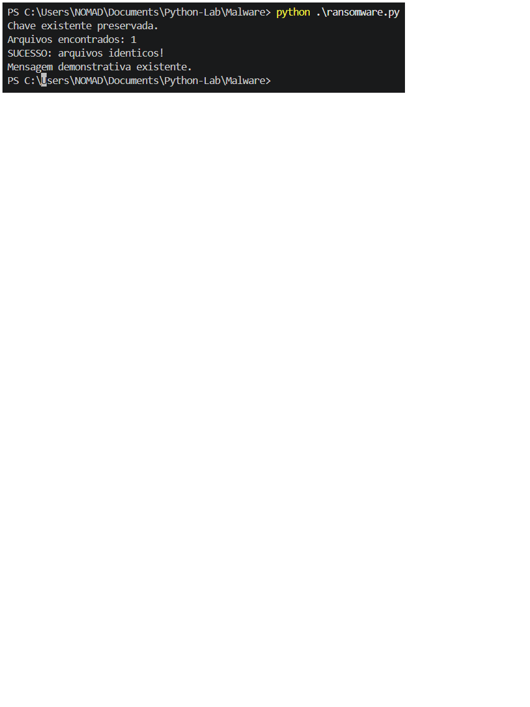
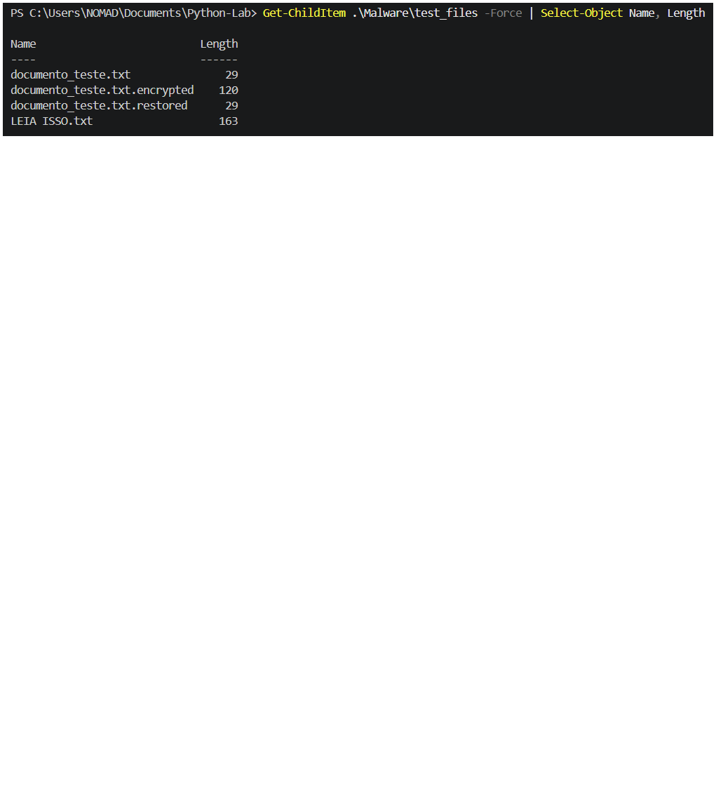

# 🔐 Simulação Educacional de Ransomware com Python

## 📌 Sobre o projeto

Este projeto foi desenvolvido como atividade prática dos estudos de Cibersegurança, com o objetivo de compreender conceitos fundamentais de criptografia simétrica, manipulação de arquivos e recuperação de dados utilizando Python.

A implementação simula, em ambiente local e controlado, o processo de criptografia e descriptografia de um arquivo de teste, utilizando a biblioteca Fernet, disponibilizada pelo pacote `cryptography`.

O projeto possui finalidade exclusivamente educacional.

## 🎯 Objetivos

- Compreender o funcionamento da criptografia simétrica.
- Implementar a geração e o armazenamento de uma chave criptográfica.
- Criptografar um arquivo fictício de teste.
- Descriptografar o arquivo utilizando a chave correspondente.
- Verificar a integridade dos dados recuperados.
- Aplicar tratamento de exceções e boas práticas de manipulação de arquivos.

## 🛠️ Tecnologias e ferramentas

- Python 3.13.15
- Biblioteca `cryptography`
- Fernet
- Visual Studio Code
- PowerShell
- Windows 11

## 📂 Estrutura do projeto

```text
Ransomware/
│
├── README.md
├── ransomware.py
├── requirements.txt
├── .gitignore
│
└── images/
    ├── ransomware-execution.png
    └── ransomware-files.png
```

A estrutura acima representa a organização planejada para publicação no GitHub. A chave criptográfica e os arquivos gerados durante os testes permanecem no ambiente local.

## ⚙️ Funcionamento

O programa está organizado em funções independentes:

### 1. Preparação do laboratório

Cria o diretório de testes e prepara um arquivo fictício, caso ele ainda não exista.

### 2. Geração da chave

Utiliza `Fernet.generate_key()` para gerar uma chave criptográfica e armazená-la em `chave.key`, preservando uma chave já existente.

### 3. Carregamento da chave

Lê a chave armazenada para utilizá-la nas operações criptográficas.

### 4. Criptografia

Lê o conteúdo do arquivo original, aplica a criptografia Fernet e salva o resultado em um novo arquivo com a extensão `.encrypted`.

### 5. Descriptografia

Recupera os dados utilizando a chave correspondente e grava o conteúdo recuperado em um arquivo com a extensão `.restored`.

### 6. Verificação de integridade

Compara os dados binários do arquivo original com os dados recuperados, verificando se ambos são idênticos.

### 7. Tratamento de exceções

Utiliza mecanismos de tratamento de erros, incluindo `FileExistsError` e `InvalidToken`, para lidar com situações específicas durante a execução.

## ▶️ Como executar

Com Python instalado, instale as dependências:

```powershell
python -m pip install -r requirements.txt
```

Execute o programa:

```powershell
python ransomware.py
```

A execução deve ocorrer exclusivamente em um ambiente de laboratório controlado, utilizando arquivos fictícios.

## 🧪 Resultado da execução

Saída observada no terminal:

```text
Chave existente preservada.
Arquivos encontrados: 1
SUCESSO: arquivos identicos!
```

Arquivos produzidos durante a execução:

| Arquivo | Resultado |
|---|---|
| `documento_teste.txt` | Original preservado |
| `documento_teste.txt.encrypted` | Versão criptografada |
| `documento_teste.txt.restored` | Versão recuperada |
| `LEIA ISSO.txt` | Mensagem demonstrativa |

A comparação binária confirmou que o conteúdo recuperado corresponde exatamente ao conteúdo original.

## 📸 Evidências do laboratório

### Execução do programa

[Evidência da execução do programa](https://github.com/ELEMENT0HACKER/Project-Lab/blob/main/Ransomware/Images/ransomware-execution.png) ([image](https://github.com/ELEMENT0HACKER/Project-Lab/raw/main/Ransomware/Images/ransomware-execution.png))

### Inspeção dos arquivos

[Evidência dos arquivos do laboratório](https://github.com/ELEMENT0HACKER/Project-Lab/blob/main/Ransomware/Images/ransomware-files.png) ([image](https://github.com/ELEMENT0HACKER/Project-Lab/raw/main/Ransomware/Images/ransomware-files.png))


## 🔒 Considerações de segurança

Este projeto é uma simulação educacional, executada em ambiente local e controlado, e não deve ser utilizado contra sistemas, arquivos ou dispositivos de terceiros.

A chave criptográfica deve ser protegida e armazenada separadamente dos dados criptografados em aplicações reais.

A implementação não representa um ransomware de produção e não deve ser interpretada como um mecanismo de proteção ou recuperação de dados para ambientes reais.

## 📚 Aprendizados

Durante o desenvolvimento foram praticados:

- Manipulação de arquivos com Python.
- Operações de leitura e escrita binária.
- Criptografia e descriptografia com Fernet.
- Geração e persistência de chaves.
- Estruturas condicionais.
- Funções e modularização.
- Tratamento de exceções.
- Verificação de integridade de dados.
- Depuração e correção de erros.

## 👨‍💻 Autor

Projeto desenvolvido como parte da formação em Cibersegurança da DIO.

**Áreas de estudo:** Cybersecurity | Python | Criptografia | Segurança da Informação


---

## 📸 Evidências da execução

### 1. Execução do Ransomware



### 2. Arquivos do laboratório



